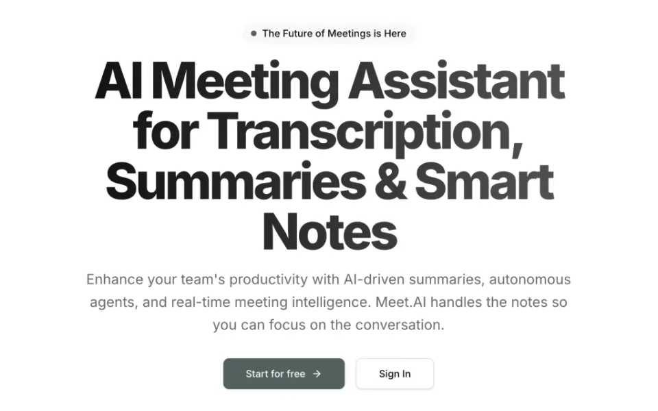
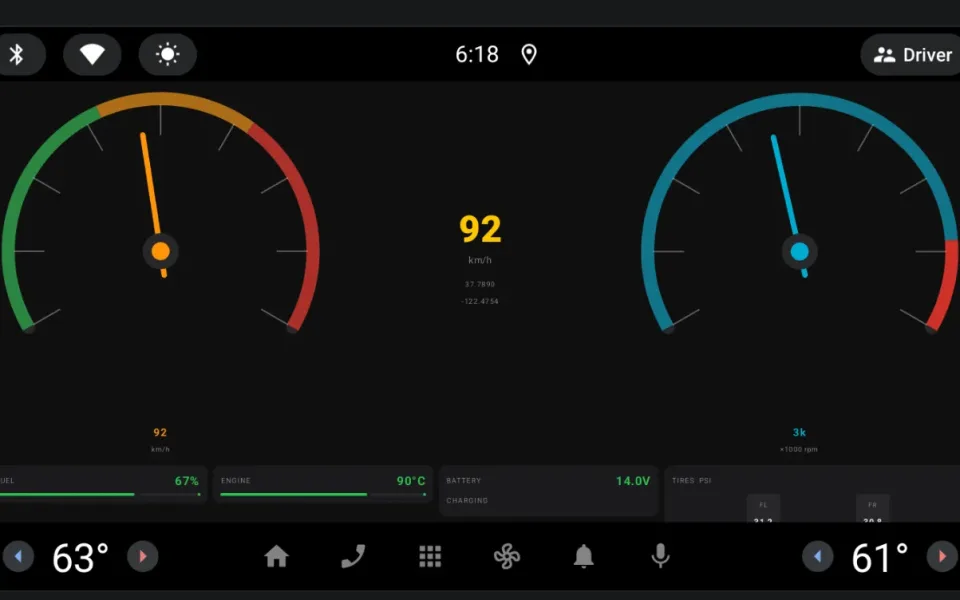
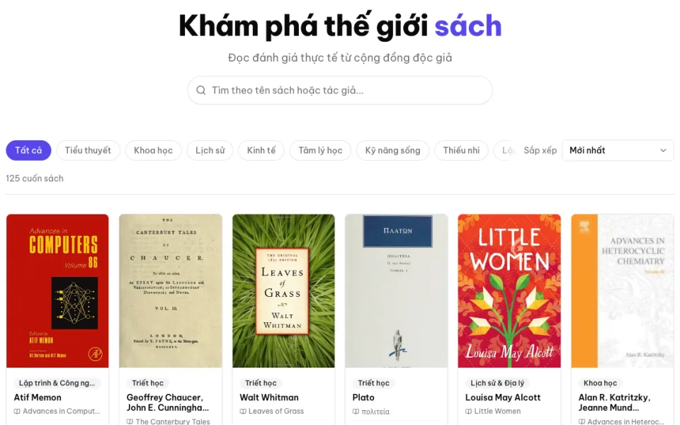

# Lê Văn Trung Tính

**Software Engineer · AI Product Builder** — Da Nang, Vietnam

I build practical software end to end: typed APIs and data models on the backend, web and Android clients on the front, and AI features where they solve a real user problem. Most of my work is in **Java / Spring Boot** and **TypeScript** (Node.js, NestJS, Fastify, Next.js), with **PostgreSQL** as my default data store.

[trungtinh.site](https://trungtinh.site) · [LinkedIn](https://www.linkedin.com/in/trung-t%C3%ADnh-l%C3%AA-v%C4%83n-b72669297/) · [levantrungtinh13@gmail.com](mailto:levantrungtinh13@gmail.com)

## Featured projects

<table>
  <tr>
    <td width="44%" valign="top">
      
    </td>
    <td valign="top">
      <b><a href="https://github.com/tinhne/meetai">Meet.AI</a></b> — AI meeting assistant  
      Video meetings with a custom AI agent in the call. A real-time voice agent joins the meeting; afterwards a background job turns the transcript into a summary you can search and question.  
      Next.js · tRPC · Drizzle · PostgreSQL (Neon) · Stream · OpenAI Realtime · Gemini · Inngest · Polar  
      <a href="https://meetai-assistant.vercel.app">Live demo</a> · <a href="https://github.com/tinhne/meetai">Source</a>
    </td>
  </tr>
  <tr>
    <td width="44%" valign="top">
      
    </td>
    <td valign="top">
      <b><a href="https://github.com/tinhne/vehicle-telemetry">Vehicle Telemetry</a></b> — real-time in-car dashboard  
      A Spring Boot service streams simulated sensor data at ~10 Hz over STOMP/WebSocket to a Jetpack Compose dashboard for Android Automotive OS, with a stateful warning engine and throttled async persistence.  
      Spring Boot · Java 21 · WebSocket/STOMP · PostgreSQL · Kotlin · Jetpack Compose · Docker  
      <a href="https://github.com/tinhne/vehicle-telemetry">Source</a>
    </td>
  </tr>
  <tr>
    <td width="44%" valign="top">
      
    </td>
    <td valign="top">
      <b><a href="https://github.com/tinhne/book_review">Book Review Platform</a></b> — full-stack review site  
      A JWT-secured Spring Boot REST API with role-based access, server-side search and pagination, and transactional rating updates, plus a React client with URL-driven filters.  
      Spring Boot · Spring Security · JPA · PostgreSQL · React · TypeScript · TanStack Query  
      <a href="https://book-review-frontend-eta.vercel.app">Live demo</a> · <a href="https://github.com/tinhne/book_review">API</a> · <a href="https://github.com/tinhne/book-review-frontend">Client</a>
    </td>
  </tr>
</table>

**More work**

| Project | What it is | Stack |
| --- | --- | --- |
| [Medical Diagnosis Chatbot](https://github.com/tinhne/capstons2) | Team capstone: chat-based symptom intake, XGBoost disease prediction, and doctor hand-off. I built the auth module and the ML service. | Spring Boot · FastAPI · XGBoost · Gemini · React |
| [Personal Blog API](https://github.com/tinhne/blogFinalProject) | Blog backend with email verification, JWT access/refresh tokens, draft→publish workflow, and generated OpenAPI docs. | Fastify · TypeScript · Prisma · PostgreSQL · Zod |
| [DevHelp Bot](https://github.com/tinhne/Devhelp-mezon) | Team entry for the Mezon Bot Challenge: a chat bot for saving commands and tracking bugs and their fixes. | NestJS · TypeORM · PostgreSQL |
| [Clinic Management](https://github.com/tinhne/Clinic-Management) | Team project: appointment booking, medical records, and online consultations for a clinic. | Express · MongoDB · React |

## Technical focus

| Area | Technologies |
| --- | --- |
| Languages | TypeScript, JavaScript, Java, Kotlin, Python, SQL |
| Backend | Spring Boot (Security, Data JPA, WebSocket), NestJS, Fastify, Express, tRPC, FastAPI, REST |
| Frontend & mobile | React, Next.js, Tailwind CSS, shadcn/ui, TanStack Query, Jetpack Compose (Android Automotive) |
| Databases | PostgreSQL, MySQL, MongoDB · Prisma, Drizzle, JPA/Hibernate, TypeORM, Mongoose |
| AI & automation | OpenAI Realtime API, Google Gemini API, XGBoost, scikit-learn, pandas, Inngest background jobs |
| Cloud & DevOps | Docker, Docker Compose, Vercel, Render, Neon, Linux, Bash |
| Tools | Git, pnpm, Postman, ESLint, Prettier, Husky |

## Experience

**Backend Developer Intern** · [Tomosia Vietnam](https://tomosia.com) · Da Nang · Mar 2025 – Oct 2025\
Built and maintained backend services with Node.js (Fastify) and TypeScript following Clean Architecture, designed REST and tRPC APIs, containerized services with Docker and automated workflows with Bash, and contributed Next.js + shadcn/ui components to internal tools.

**Power BI Tutor** · Hoc Cung Chuyen Gia · Jan 2025 – May 2025\
One-on-one tutoring in data modeling, DAX, and dashboard design.

**Bachelor of Information Technology** · Duy Tan University · Da Nang · Aug 2021 – Jun 2025

## Activities & recognition

- **Top 30 Finalist** — LG Dream Code 2026, LG Electronics R&D Vietnam
- **Contestant** — Mezon Bot Challenge 2025 (team project: DevHelp Bot)
- **Cyber Security Fundamentals** (16 hours) — AGEST Vietnam × Duy Tan University, Sep 2024
- **Participant** — Build with AI workshop, GDG Central
